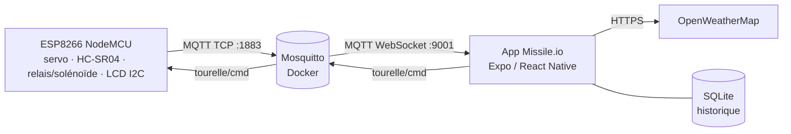
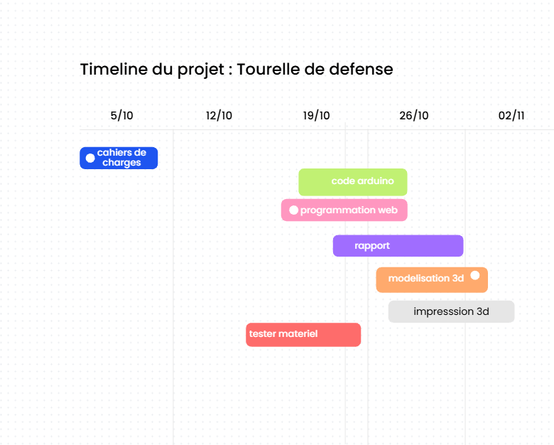
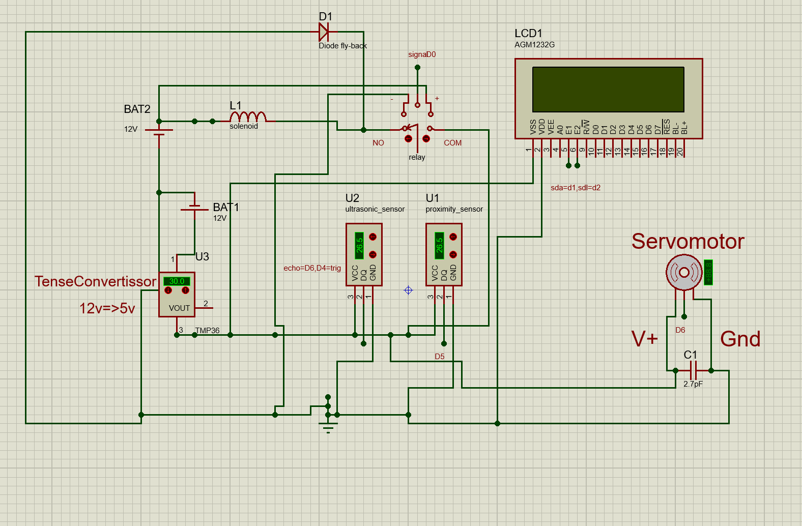
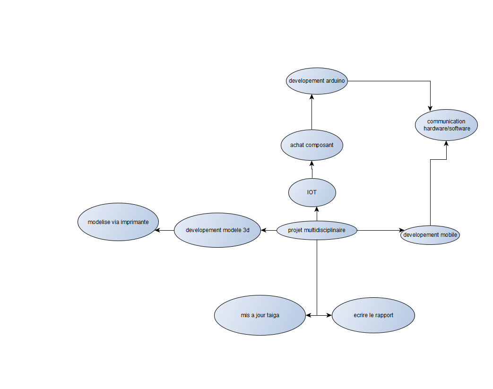

# Prj3.2 — Tourelle de détection connectée (Missile.io)

Tourelle à solénoïde pilotée par un **ESP8266**. Un servo balaie de 0 à 180° par pas de 5°, un capteur ultrason **HC-SR04** mesure la distance, et le solénoïde tire (impulsion de 50 ms via un relais) quand une cible passe sous **20 cm**.

Chaque détection est publiée en **MQTT** sur un broker **Mosquitto** (Docker). L'app **Missile.io** (Expo / React Native) affiche les détections en direct, la météo du moment (OpenWeatherMap), l'historique stocké en SQLite avec export CSV, et permet d'armer ou désarmer la tourelle à distance.

## Architecture



## Structure du dépôt

| Dossier | Contenu |
|---|---|
| `code/` | App Expo SDK 57 (React Native 0.86) : `app/HomeP.tsx` (live + commandes), `app/Historic.tsx` (graphes + export CSV), `lib/db.ts` (expo-sqlite) |
| `firmware/tourelle/` | Sketch principal de la tourelle |
| `firmware/mqtt_test/` | Sketch de test de la connexion Wi-Fi / MQTT |
| `broker/` | `docker-compose.yml`, config Mosquitto (`mosquitto.conf`, `acl`), script de diagnostic `diag-mqtt.ps1` |
| `docs/` | Cahier des charges, Gantt, schéma ISIS, mind map |

## Topics MQTT

| Topic | Sens | Contenu | Retenu |
|---|---|---|---|
| `tourelle/tir` | ESP → app | `{"angle":95,"dist_cm":14.8,"servo_ok":true,"uptime_ms":123456}` | non |
| `tourelle/status` | ESP → app | `online` / `offline` (dernière volonté LWT) | oui |
| `tourelle/arme` | ESP → app | `oui` / `non` | oui |
| `tourelle/position` | ESP → app | `ok` / `erreur` (fin de course du servo) | oui |
| `tourelle/cmd` | app → ESP | `armer` / `desarmer` | non |

L'ACL limite chaque compte : `tourelle` publie ses topics et lit `tourelle/cmd`, `webapp` lit `tourelle/#` et publie uniquement `tourelle/cmd`.

## Câblage (NodeMCU 1.0)

| Composant | Broche |
|---|---|
| HC-SR04 TRIG | D4 (GPIO2) |
| HC-SR04 ECHO | D6 (GPIO12) — 3,3 V max : pont diviseur si le capteur est alimenté en 5 V |
| Servo | D5 (GPIO14) |
| Relais du solénoïde | D0 (GPIO16) |
| Fin de course du servo | D7 (GPIO13), contact vers GND |
| LCD I2C 16×2 (0x27) | SDA = D1, SCL = D2 |

## Installation

### 1. Broker MQTT

```powershell
cd broker
# créer les deux comptes (le fichier passwd n'est pas versionné)
docker run --rm -v ${PWD}/mosquitto/config:/mosquitto/config eclipse-mosquitto mosquitto_passwd -c -b /mosquitto/config/passwd tourelle MDP_TOURELLE
docker run --rm -v ${PWD}/mosquitto/config:/mosquitto/config eclipse-mosquitto mosquitto_passwd -b /mosquitto/config/passwd webapp MDP_WEBAPP
docker compose up -d
```

En cas d'erreur `etat=-2` côté ESP, lancer `diag-mqtt.ps1` dans un PowerShell administrateur. Il vérifie le conteneur, l'IP du PC et les ports, et ajoute la règle du pare-feu Windows pour 1883 et 9001.

### 2. Firmware ESP8266

1. Arduino IDE, carte **NodeMCU 1.0 (ESP-12E Module)**.
2. Bibliothèques : `PubSubClient`, `LiquidCrystal_I2C` (`Servo` est fourni avec le core ESP8266).
3. Copier `firmware/tourelle/secrets.example.h` en `secrets.h` et le remplir (Wi-Fi 2,4 GHz, IP du PC, mot de passe `tourelle`).
4. Téléverser `firmware/tourelle/tourelle.ino`.

### 3. App Missile.io

```powershell
cd code
copy .env.example .env   # puis remplir l'IP du PC, le mot de passe webapp et la clé OpenWeatherMap
npm install
npx expo start
```

- **Web** : ouvrir http://localhost:8081. expo-sqlite exige localhost ou HTTPS.
- **Téléphone** : Expo Go compatible SDK 57, sur le même réseau Wi-Fi que le PC.

> L'IP du PC est attribuée par la box. Réserve-la dans la box (bail DHCP statique), sinon il faudra mettre à jour `secrets.h` et `.env` à chaque changement d'adresse.

## Documentation

- [Cahier des charges (PDF)](docs/Cahiers%20des%20charges_2627_drab.pdf)

| Gantt | Schéma ISIS | Mind map |
|---|---|---|
|  |  |  |

---

Projet 3.2 — Informatique industrielle, HELHa Charleroi, 2026-2027.
